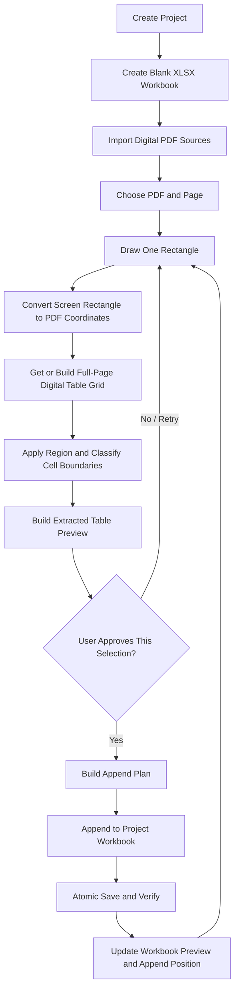

# Document Harvester — MVP Implementation Blueprint

**Document ID:** DH-MVP-IB-001  
**Version:** 0.1 — Draft for owner review  
**Date:** 20 November 2026  
**Repository:** [SMozaff/Document-Harvester](https://github.com/SMozaff/Document-Harvester)  
**Target branch baseline:** `main` at commit `3fe129f1ecd799f08705dcdb8d6a2d0a2e75d5e6`  
**Requirements source:** [`MVP_TECHNICAL_MANIFEST.md`](MVP_TECHNICAL_MANIFEST.md)  
**Architecture source:** [`document_harvester_manifest_v5.1.md`](../document_harvester_manifest_v5.1.md) and the existing `docs/` specifications  
**Target:** Digital PDF Region Capture → one accumulating Excel workbook

> **Document status:** This is an implementation plan, not a claim that implementation has started or that any dependency has been selected. Pending owner decisions and Phase 0 evidence gates remain visible below. The MVP Technical Manifest defines the required product behavior; this document explains how to implement it in the current repository.

---

## 1. Executive summary

The MVP should be built by extending the existing Rust workspace. Do not create a second application or replace the repository's crate structure without evidence that the current structure cannot support the requirements.

The core workflow is:

1. Create a new project, which owns one blank Excel workbook.
2. Import one or more digital PDFs into the project.
3. Display a PDF page and let the user draw one rectangular region around one table or data area.
4. Reconstruct the selected table's rows, columns and cells automatically from the PDF's digital text and positional information.
5. Show a preview and warnings.
6. The user approves that one selection.
7. The application appends the approved table immediately below all previously approved content in the same workbook, without inserting a separator row.
8. Return to the PDF viewer ready for the next selection.

The user controls layout compatibility. The application must preserve each selection's detected structure; it must not map columns, rename columns, or reshape a later table to match an earlier selection.

The most important architectural change is to replace Part 3's old **one rectangle → one separate workbook** export model with **one project → one workbook → repeated individually approved appends**.

## 2. Implementation principles

1. **Use the existing workspace.** Keep `dh-ir`, `dh-core`, `dh-part1`, `dh-part3`, `dh-writer`, `dh-ui` and `dh-app` as the starting architecture.
2. **One shared data model.** Reuse `TableBlock`, `Cell`, `BBox`, `Provenance`, `CellState` and the existing reason-code model. Do not introduce a second table representation for region capture.
3. **One workbook writer.** Extend `dh-writer`; do not build a separate Excel writer inside Part 3.
4. **Preview is not a commit.** Extracting and previewing must never alter the workbook. Approval is the single commit point for one selection.
5. **One selection at a time.** Do not provide multi-rectangle batch approval in this MVP.
6. **No schema assumptions.** Do not require the next table to have the same number of columns as the previous table.
7. **No separator rows between approved selections.** Preserve blank rows that are genuinely part of one extracted table, but do not add an extra row between two selections.
8. **No silent data loss.** Do not silently truncate cells, drop boundary-crossing content, or convert ambiguous values to numbers.
9. **Keep the UI responsive.** PDF parsing, table reconstruction and workbook writes must not block the Slint event loop.
10. **Evidence before dependency adoption.** A candidate library is not approved until its identity, version, license, API capability, platform behavior and packaging route are verified.
11. **Do not silently approve old proposals.** D7–D14 and the open questions in the MVP manifest remain pending until the owner decides them.

## 3. Target architecture

### 3.1 Responsibility map

| Existing crate | MVP responsibility | What it should not own |
|---|---|---|
| `dh-ir` | Shared representation of extracted tables, cells, geometry, text order, numeric information and provenance | PDF rendering, project UI or Excel file I/O |
| `dh-core` | Shared policies: validation, normalization, numeric rules, reason codes, state helpers and safe-publish utilities | Slint components or Part-specific orchestration |
| `dh-part1` | Digital PDF text extraction, font/run information and page/table grid reconstruction | Workbook lifecycle or UI callbacks |
| `dh-part3` | Region coordinate handling, containment checks, selection filtering, page cache, warnings, preview result and approval workflow | A separate Excel-writing implementation |
| `dh-writer` | Create blank workbook, append approved table data, validate Excel limits and safely save the workbook | PDF parsing or rectangle interaction |
| `dh-ui` | Slint screens, PDF viewer surface, rectangle overlay, preview, warning list and user actions | Direct PDF parsing or direct XLSX manipulation |
| `dh-app` | Application startup, project lifecycle, source-PDF registration and wiring between UI, Part 3 and writer | Reimplementing extraction or workbook policies |
| `dh-part2` | Reserved for later OCR support; not required for the digital-only MVP | Required path for MVP digital PDFs |

Maintain the existing one-way dependency direction. `dh-core` must not depend on a Part; no Part should depend on `dh-app`; the UI must receive plain data rather than sharing Slint models with worker threads.

### 3.2 High-level processing flow



A PDF page is rendered for display only. For a digital PDF, extraction uses the PDF text layer and its positions; it must not use OCR on the viewer image.

### 3.3 Single active capture state

The application should enforce one active selection lifecycle per project:

```text
Ready
  → RegionSelected
  → Extracting
  → PreviewReady
  → CommitPending
  → Saved
  → Ready
```

Other outcomes:

- `PreviewReady → RegionSelected` when the user retries or changes the rectangle.
- `PreviewReady → Ready` when the user cancels the preview without approving.
- `CommitPending → PreviewReady` when saving fails and the user can retry the commit.
- A new selection must not begin while a commit is in progress.

The workbook changes only after a successful commit. The UI must not display a success state before the writer confirms that the updated workbook was saved and verified.

## 4. Project and workbook lifecycle

### 4.1 Project model

A project represents one accumulating workbook. It is not one PDF and it is not one selection.

At runtime the application needs a project session containing, at minimum:

- Project identity.
- The target workbook path and current saved-file identity/hash.
- The active worksheet used for appending.
- The current append position.
- Imported PDF source records (at least path and content hash for the current session).
- The currently selected PDF and page.
- The pending selection and preview, if any.
- The last successful commit result.

This is a conceptual contract, not a demand to add a new crate. Project orchestration belongs in `dh-app` or a focused module owned by it; region extraction remains in `dh-part3`, and Excel operations remain in `dh-writer`.

### 4.2 Blank workbook creation

When the user invokes **New Project**, the application must:

1. Start a new project session; it must not reuse a previous project's in-memory state.
2. Create one valid `.xlsx` workbook with one empty append destination worksheet.
3. Establish the workbook's saved path according to the approved project-save policy.
4. Initialize the append cursor at the first row of the worksheet.
5. Make the project ready for PDF import.

Do not create a template, headings, sample data, hidden review sheet, source labels, or decorative content. The exact worksheet name is not yet owner-confirmed; do not hard-code a product-specific name without recording the decision.

### 4.3 Project persistence decision

The workbook is the project's primary output, but the current requirements do not yet specify how the application should persist the imported PDF list, selection history, active page, or unfinished project metadata after the application closes.

Before implementing reopen/recovery behavior, decide whether:

- the project is only the `.xlsx` file and PDFs are re-imported when reopening; or
- the project has an application-managed folder/metadata record that points to the workbook and source PDFs.

Use the owner-approved private state store in the OS application-data area. Do not create sidecar files beside the workbook or store hidden application state in the workbook. The workbook itself remains clean.

### 4.4 Source PDF identity

For each imported PDF, compute a content hash and retain the original path for the session. The hash is used to invalidate cached extraction results when the file changes. If a source file disappears or its content changes, show a clear message; never silently substitute another file with the same name.

Whether PDFs are copied into project storage or referenced in place is pending. The design must isolate this decision behind the source-file management layer.

## 5. Region-capture processing design

### 5.1 PDF viewer and coordinate system

The viewer must support page navigation, zoom, pan, and one draggable/resizable rectangle.

Keep a single canonical geometry representation in PDF page user-space coordinates. The screen rectangle is only a visual representation. A conversion layer must account for:

- Current zoom.
- Pan/scroll offset.
- Page rotation.
- `CropBox` and `MediaBox` offsets.
- High-DPI and operating-system display scaling.

Normalize every rectangle so `x0 < x1` and `y0 < y1`; reject zero-area or out-of-page selections with a visible error. Store the canonical page-space rectangle with the preview/provenance.

Do not duplicate coordinate conversion logic in Slint callbacks, `dh-part3`, and the PDF renderer. The UI should report pointer positions and display geometry; a tested geometry layer should produce the page-space `BBox`.

### 5.2 Full-page grid first

For the selected page, the extraction path should build or retrieve the page's digital table/cell grid before applying the selected rectangle.

Why: if the application only crops text to the rectangle first, it may not know that a cell extends outside the rectangle. Building the full-page grid first allows it to identify cells whose boundaries cross the selection edge.

The grid result should use the existing `TableBlock` and `Cell` model. Do not create a second IR for region mode.

### 5.3 Digital PDF validation

The MVP handles digital PDFs with a usable text layer. On import or page selection, detect pages that do not provide usable digital text/position information.

For a page without a usable text layer:

- Do not return an empty table as if extraction succeeded.
- Do not silently OCR the viewer image.
- Show that the page is image-only or unsupported by the digital MVP.
- Keep OCR as a later Part 2 capability.

### 5.4 Applying the region

`dh-part3::region` should:

1. Validate the page-space rectangle.
2. Select only table blocks/cells relevant to the rectangle.
3. Classify each cell as fully contained or partial using the cell bounding box and available text-run geometry.
4. Preserve row and column positions, including empty cells that are part of the detected grid.
5. Mark boundary-crossing cells as `CellState::Partial` and attach the existing `PartialCell` reason code.
6. Return an extracted preview model plus warnings; it must not write to Excel.

A text run that crosses the rectangle edge can make its containing cell partial even where the overall cell box appears contained. Merged cells/ranges that cross the edge are also partial.

The existing Part 3 requirement for a zero-miss boundary test remains in force. The test-set size and a numerical false-alarm ceiling remain open; proposed values in the base manifest are not binding until approved.

### 5.5 Ruleless and multi-table regions

The original v5.1 Part 3 policy says not to invent a grid when a region has text but no reliable ruling/grid evidence. The MVP manifest records ruleless-table handling as an open product question. The implementation must make the outcome explicit and testable; do not add speculative table inference as an unnoticed default.

The user's intended interaction is one selected table/area at a time. The old D14 behavior for multiple tables inside one rectangle (stack them with a blank row) conflicts with the new requirement that approved selections append with no additional separator row. Until the owner confirms the behavior, detect and report multiple distinct tables in one rectangle rather than silently stacking them or inserting a blank separator.

### 5.6 Page cache

Reuse `dh-part3::cache::PageCache` for the expensive full-page result. The existing `PageCacheKey` already provides the main dimensions:

- PDF content SHA-256.
- Page number.
- Extractor version.
- Relevant policy-version identifiers.

A changed source hash, extractor version, or relevant policy version must prevent stale results from being reused. A rectangle change alone should reuse the full-page grid and re-run only the region filtering/reconstruction stage.

The cache must not become the authoritative project record. It is a performance optimization and may be discarded safely.

## 6. Preview, warnings and approval

### 6.1 Preview contract

The preview should show the extracted grid in the same row/column structure that will be written. It should also show:

- Source PDF name and page.
- Current rectangle location (or a way to return to it on the PDF page).
- Cell/table warnings.
- Whether the current result is eligible for approval under the approved alert policy.

The preview is temporary. It must not mutate the workbook, advance the append cursor, or leave written rows behind when the user retries or cancels.

### 6.2 Warning model

Reuse `dh-part3::alerts::RegionAlert` and `dh-core::reason::ReasonCode` where possible. Warnings should be clickable and should highlight the corresponding cell/region on the PDF page.

Relevant warning families inherited from v5.1 include:

- `partial-cell`.
- `ruleless-region`.
- `multiple-tables`.
- Unvalidated font or uncertain text-order warnings.
- Invalid/unresolved codepoint or presentation-form warnings.
- `numeric-uncertain`.
- Excel cell/text/output-limit errors.

Do not add an in-cell marker, review worksheet, hidden data, PDF label, or sidecar report to the final workbook. Persistent warning history after the project closes is an open decision; no persistence mechanism is approved here.

### 6.3 Approval gate

`dh-part3::alerts::evaluate` should return an explicit gate, not a boolean inferred across UI code. The current scaffold already defines:

- `Allowed`.
- `RequiresConfirmation(...)`.
- `Disabled(...)`.

The exact mapping of warning types to these outcomes depends partly on pending D14. Before implementation acceptance, the owner must settle partial-cell behavior. Until then, the safest implementation default is to prevent a partial value from entering the workbook silently and to keep the selection in preview until the user redraws or explicitly chooses an approved blank-cell policy.

### 6.4 Approval is the commit point

The UI should call one application command such as `approve_current_selection`. It should not independently write to the workbook or call the writer directly.

The application command should pass an immutable preview/result identity and append intent to the project orchestrator. It must verify that the preview still belongs to the current PDF hash, page, rectangle and policy versions. A stale preview must be regenerated rather than committed.

## 7. Workbook append and save design

### 7.1 Append semantics

All approved selections are written into the same project's append destination worksheet.

- The first selection begins at the first row of the blank worksheet.
- A later selection begins on the row immediately after the previous selection's allocated grid height.
- No blank separator row is added between separate selections.
- No automatic column mapping or column reordering occurs.
- Each selection preserves its own detected number of rows and columns.
- Different selections may have different column counts.
- Empty cells and blank rows that belong to a selected table's detected grid are preserved.
- Merged ranges, if supported by the extracted grid and writer, must be shifted by the same row offset as their selection.

Do not calculate the insertion point only by searching for the last non-empty cell. That can collapse intentional empty rows or be confused by formatting. Maintain an append cursor from the committed table dimensions, and reconcile it with the actual workbook on project open.

### 7.2 Append plan

Before writing, construct an append plan that includes:

- Project/workbook identity.
- Source PDF content hash, path identity, page and selected page-space rectangle.
- Preview/selection ID and extraction policy versions.
- Target worksheet.
- Start row and end row (using one clearly documented indexing convention).
- Table row/column dimensions.
- Cell values, numeric/text classification and formatting metadata.
- Merged ranges translated by the append row offset.
- Any approved warnings and the user's confirmation decision, without writing warning markers into the worksheet.

The plan should be validated before the workbook changes. An invalid plan must be rejected without touching the existing workbook.

### 7.3 Transaction-like commit sequence

Treat one approved selection as one workbook transaction:

1. Confirm that the project is open and no other commit is running.
2. Confirm the PDF hash and preview identity still match.
3. Validate the append plan, Excel limits and alert gate.
4. Build the updated workbook state in memory or through a backend that can safely read and modify the current workbook.
5. Write to a temporary file in the same destination directory.
6. Close/flush the temporary output and verify it can be reopened/read and that expected values/dimensions exist.
7. Replace the previous workbook using a tested platform-specific atomic replacement strategy.
8. Only after successful replacement, update the in-memory append cursor and mark the selection committed.
9. Update the UI to show the successful append and the next available row.
10. Clean temporary files.

Before step 1, verify that Excel (and any other process holding an incompatible lock) has closed the target workbook. If the workbook is locked, do not start the write: retain the pending preview, show an actionable message to close Excel, and allow retry. The MVP does not support live commits while the workbook is open in Excel.

On any failure before replacement, preserve the last valid workbook and keep the preview available for retry. A retry must not duplicate an already committed selection. After replacement, persist the commit result and capture-history record using a recoverable transaction protocol; recovery must reconcile workbook identity/content with the private journal and must never silently rebuild over an externally changed workbook.

### 7.4 Idempotency and duplicate prevention

Each pending selection needs a stable ID within the project session. The orchestrator must remember whether that selection has committed. A second approval event for an already committed selection must be rejected or return the previous commit result; it must not append the same data again.

If the application crashes during save, startup recovery must determine whether the previous workbook or the new workbook is valid. The final policy depends on the project-persistence decision, but at minimum there must never be a half-written workbook presented as the completed project workbook.

### 7.5 Critical Excel-library feasibility issue

The current `docs/DEPENDENCIES.md` lists `rust_xlsxwriter` as a candidate and explicitly records it as **not adopted**. Its current official documentation says it creates new `.xlsx` files and cannot read or modify an existing workbook. That is a material issue for this MVP because the user expects repeated approvals to update one existing workbook.

The dependency spike must therefore prove one of these approaches before the writer is implemented:

- Select a verified Rust library that can read, modify and write an existing `.xlsx` file; or
- Keep a canonical in-memory/project data model and rebuild the complete workbook after each approval, with a verified way to reload/recover that model after the application restarts.

`umya-spreadsheet` is one candidate worth evaluating because its current documentation describes reading and writing XLSX files, but this blueprint does **not** select or approve it. Its real support for the specific features required here—merged cells, Unicode text, numeric formats, safe round-tripping, workbook size, Linux/Windows packaging and license/transitive dependencies—must be tested first.

References:

- [rust_xlsxwriter workbook tutorial](https://docs.rs/rust_xlsxwriter/latest/rust_xlsxwriter/tutorial/) — documents that the library cannot read or modify existing files.
- [umya-spreadsheet documentation](https://docs.rs/umya-spreadsheet/latest/umya_spreadsheet/) — describes XLSX reading and writing; candidate only, not an approved dependency.

This feasibility check is a **Phase 0 blocker for the append implementation**, not a minor optimization.


### 7.6 External modification, workbook lock and round-trip guard

The owner has chosen a close-before-commit workflow. The application must verify that the target workbook is accessible for the required operation before beginning a commit or undo. A lock/unavailable result is a recoverable condition: retain the pending preview, report that Excel must be closed, and allow retry. Do not discard the preview or report success.

Before append, recovery or undo, compare the workbook's identity and recorded last-committed state with the private project record. If the workbook has been modified outside Document Harvester, stop and report the mismatch. Do not rebuild from stale state, overwrite the external changes, or advance the append cursor based only on stale metadata.

The XLSX feasibility spike must include a workbook containing charts, formulas, styles, merged ranges, row heights and column widths, then read/modify/write and verify those features independently. Also test manually edited workbook variants. Since the project starts with a blank workbook, preservation of arbitrary external Excel features is not assumed; the application must not promise fidelity until the candidate library proves it. If a feature cannot be preserved safely, detect the condition where possible and refuse the operation rather than silently dropping it.

### 7.7 Capture history and undo

The owner approved both a capture list and undo of the most recent committed capture. Each capture record should include stable capture ID, source PDF identity/hash, page, source rectangle, commit sequence, destination worksheet/range, allocated grid dimensions and transaction status. The UI must show a project-level capture list in commit order.

Undo is limited to the most recent committed capture in the MVP. It is allowed only when the workbook matches the app's last known committed state, the capture occupies the expected destination range, and the rollback cannot affect unrelated or externally edited content. Otherwise refuse undo with a clear explanation. Undo must use a transaction-like write/verify/replace process and update the private journal/history only after the workbook operation is verified. A manual edit in Excel after a commit invalidates automatic undo until the mismatch is resolved.

### 7.8 Append layout and cell-value safety

- Preserve internal blank cells and rows belonging to the captured grid.
- Define and test the policy for column widths, row heights, merged ranges and wrapped/multiline cell text across appends. Do not unexpectedly resize or alter previously committed tables.
- Treat extracted strings as text unless the existing conservative numeric classifier explicitly establishes a numeric value. Formula-like strings (for example, `=A1` or `+SUM(A1:A2)`) must be written as literal text, never as executable formulas. Ambiguous strings such as `00125`, `1E5` or `3/4` must not be auto-converted to numbers or dates.
- Distinguish source PDF coordinates/cell identities from destination worksheet addresses in warnings and diagnostics.

## 8. UI implementation plan

### 8.1 Main screen

Adapt `crates/dh-ui/ui/MainWindow.slint` and `RegionView.slint` rather than creating an unrelated UI path.

Recommended screen composition:

- Project toolbar: New Project, project name/status, Save/Save As if required by the agreed save model.
- PDF source selector: imported PDFs and current source.
- PDF viewer: page navigation, zoom, pan and the actual PDF page rendering surface.
- Selection overlay: one rectangle with move/resize handles.
- Extraction controls: Extract, Retry/Change Region, Approve, Cancel.
- Preview area: reconstructed cells in a grid.
- Warning area: warning code/reason, affected cell address and click-to-highlight behavior.
- Workbook context: the current append row and, subject to owner confirmation, a view of recently appended workbook rows.

A full live workbook preview is useful but was not explicitly confirmed as mandatory. The minimum required display is the preview of the pending selection and clear confirmation of where it will be appended.

### 8.2 UI state and callbacks

Keep the current plain-data boundary in `dh-ui/src/lib.rs` (`UiProjection`, `UiBridge`, `SharedUiState`). Extend the projection for project status, PDF/page information, selection geometry, extraction preview, append destination and commit result.

Callbacks should express user intent only, for example:

- `new_project`.
- `import_pdf`.
- `select_pdf`.
- `previous_page` / `next_page`.
- `zoom_in` / `zoom_out` / `pan`.
- `selection_changed`.
- `extract_region`.
- `retry_region`.
- `approve_selection`.
- `cancel_preview`.

The callbacks should dispatch commands to the application layer. They should not contain PDF parser calls, table reconstruction logic, or workbook-writing logic.

### 8.3 Current UI scaffold gap

The existing `RegionView.slint` has a placeholder grey rectangle and a hard-coded red selection rectangle. It has buttons and properties for import, navigation, zoom, extract, retry, export and alerts, but no actual PDF rendering widget, pointer-driven rectangle geometry, project lifecycle, or commit-to-workbook behavior. `MainWindow.slint` currently exposes Batch, Triage, OCR, Review and Region tabs.

For the MVP, the Region workflow should become the primary application path. The batch/OCR screens can remain staged or hidden from the primary MVP navigation; do not spend implementation effort completing Part 2 screens for this release.

### 8.4 Threading

Follow the existing architecture's Slint threading rules:

- Parsing and extraction run off the UI thread.
- The UI receives plain Rust data and updates the projection on the UI thread.
- Do not pass Slint `ModelRc` objects to worker threads.
- Throttle progress/long-operation UI updates where relevant.
- Disable conflicting actions while a selection is extracting or committing.

## 9. Repository change map

The paths below identify the likely files to extend. New module names are suggestions for organization, not proof that files already exist.

| Path | Planned work | Priority |
|---|---|---|
| `crates/dh-ir/src/lib.rs` | Review `TableBlock`, `Cell`, `BBox`, `Provenance` and `CellState::Partial`; add only missing, justified source/selection metadata while preserving the shared IR | High |
| `crates/dh-core/src/config.rs` | Define the MVP's explicit project/selection configuration boundary; resolve how existing `ColumnOrder` is selected and scoped | High |
| `crates/dh-core/src/reason.rs` | Reuse existing reason codes; add a code only when a real, distinct condition needs one | High |
| `crates/dh-core/src/publish.rs` | Reuse or adapt atomic file-publish primitives for workbook replacement, with Linux/Windows tests | High |
| `crates/dh-part1/src/extractor.rs` | Implement digital extraction and expose page-level access needed by Part 3 without creating another parser path | High |
| `crates/dh-core/src/grid.rs` | Implement/complete page grid reconstruction used by digital extraction | High |
| `crates/dh-part3/src/region.rs` | Implement page-space coordinate conversion, rectangle validation, cell containment and region filtering | High |
| `crates/dh-part3/src/cache.rs` | Implement content-hash invalidation and page-result cache behavior | High |
| `crates/dh-part3/src/alerts.rs` | Implement explicit alert evaluation and approval gate; keep pending D14 behavior configurable | High |
| `crates/dh-part3/src/export.rs` | Replace independent per-rectangle export flow with a project-workbook append command or a thin adapter to `dh-writer` | High |
| `crates/dh-part3/src/lib.rs` | Expose the region workflow modules and stable public contracts | High |
| `crates/dh-writer/src/lib.rs` | Implement blank workbook creation, append planning/writing, worksheet limits, cell types, merge offsets and atomic save | Critical |
| `crates/dh-ui/src/lib.rs` | Extend the plain-data UI projection and bridge for project/selection/preview/commit state | High |
| `crates/dh-ui/ui/MainWindow.slint` | Make the Region workflow the primary MVP experience and connect project commands | High |
| `crates/dh-ui/ui/RegionView.slint` | Replace placeholder rectangle with real PDF page surface and mouse-driven selection; add preview, warning and approval states | Critical |
| `crates/dh-app/src/main.rs` | Replace CLI-stub startup with application wiring and project/session lifecycle | Critical |
| `crates/dh-ui/Cargo.toml`, `Cargo.toml`, `Cargo.lock` | Add only the selected, audited UI/viewer dependencies after Phase 0 approval | Phase 0 gate |
| `crates/dh-part1/Cargo.toml`, `crates/dh-writer/Cargo.toml` | Add selected PDF and XLSX dependencies only after evidence and license approval | Phase 0 gate |
| `docs/ARCHITECTURE.md` | Update Part 3 and writer responsibilities to project-scoped append semantics | Required documentation update |
| `docs/DECISIONS.md` | Record owner decisions for the open items below; do not relabel proposals as approved without confirmation | Required documentation update |
| `docs/ACCEPTANCE.md` | Add project/workbook append tests and revise the old independent-export checklist for the MVP profile | Required documentation update |
| `docs/SCAFFOLD.md` | Update each stub as it is implemented and tested | Ongoing |
| `docs/DEPENDENCIES.md`, `docs/PHASE0.md` | Record exact dependency evidence and close gates only when evidence exists | Required gate evidence |

No new crate is required for the first implementation pass. If implementation reveals that project persistence deserves its own crate, propose that change with a dependency-boundary explanation rather than introducing it pre-emptively.

## 10. Implementation roadmap and exit criteria

### Phase 0 — Close product and technical blockers

**Purpose:** avoid choosing dependencies or coding against unresolved behavior.

Tasks:

1. Review the MVP Technical Manifest and confirm the remaining open decisions in Section 13 of that document.
2. Audit candidate PDF extraction and rendering libraries: exact Rust package identity, versions, licenses, APIs, text/run positions, font identity, Unicode order, page geometry and packaging constraints.
3. Prototype PDF rendering and pointer-to-page coordinate mapping on Linux and Windows, including rotation, CropBox/MediaBox offsets, zoom and high-DPI.
4. Run a focused Excel append feasibility spike: create blank workbook, append multiple tables with different column counts, close, reopen, append again, preserve numeric/text types and merged ranges, test formula-like literal strings, charts/formulas/styles/row heights/column widths round-trip, detect external modifications and workbook locks, and safely replace the previous file.
5. Compare Excel candidates, including read/modify/write capability; record the dependency and license decision. Do not assume `rust_xlsxwriter` can append to an existing file.
6. Verify Slint build integration and Farsi/English text display on Linux and Windows.
7. Identify a small, representative digital-PDF test set and establish expected extracted values/positions for tests. Keep held-out acceptance data separate from tuning data.

**Exit criteria:** owner-critical product decisions are recorded; PDF renderer, digital extractor and workbook backend candidates have evidence; dependency/license register is complete for every selected dependency; a prototype proves region coordinate mapping and repeated workbook append/reopen.

### Phase 1 — Lock data contracts and project session

**Tasks:**

1. Define the project session model and source-PDF identity contract.
2. Define a pending selection/preview identity that binds the PDF hash, page, page-space rectangle and policy versions.
3. Define the append-plan model, row indexing convention and worksheet target.
4. Define the exact state transitions for Ready, Selected, Extracting, PreviewReady, CommitPending and Saved/Failed.
5. Implement validation so unapproved results cannot reach the writer.
6. Keep project orchestration in `dh-app` or a focused module; keep shared policy in `dh-core`.

**Exit criteria:** unit tests prove valid/invalid state transitions, stale preview rejection, one active selection at a time, and no workbook mutation before approval.

### Phase 2 — Workbook backend and safe append

**Tasks:**

1. Implement creation of one blank workbook with one append destination worksheet.
2. Implement appending a table at an explicit row offset.
3. Preserve the selected table's exact row/column dimensions, blank cells and internal blank rows.
4. Support differing column counts across separate selections without mapping or shifting columns to a common schema.
5. Correctly shift supported merged ranges by the append offset.
6. Preserve numeric cells as numeric and text/identifier cells as text.
7. Enforce Excel limits and report errors without truncation.
8. Implement temporary write, verification and atomic replacement using tested platform adapters.
9. Implement reopen/append behavior according to the approved project persistence model.
10. Add idempotency protection so repeated approval cannot duplicate a selection.

**Exit criteria:** automated tests create a blank workbook, append three differently shaped tables, verify immediate next-row placement with no spacer, close/reopen, append another table and verify all prior data remains intact. Simulated write failures leave the last valid workbook usable.

### Phase 3 — PDF viewer and region selection

**Tasks:**

1. Integrate the selected page renderer into the Slint application.
2. Add PDF import/source selection and page navigation.
3. Add zoom and pan.
4. Implement pointer-driven rectangle draw, move and resize.
5. Convert the rectangle to canonical PDF page coordinates.
6. Store/re-display selection geometry correctly when zoom/pan changes.
7. Add coordinate mapping diagnostics for test builds.

**Exit criteria:** the same PDF rectangle is obtained at supported zoom levels, page rotations, page-box offsets and high-DPI settings; Linux and Windows pass the geometry suite.

### Phase 4 — Digital page extraction and grid reconstruction

**Tasks:**

1. Implement the selected digital PDF parser adapter in `dh-part1`.
2. Detect whether each requested page has a usable text layer.
3. Extract character/run text, positions, font identity and order evidence needed by the shared IR.
4. Reconstruct the full-page grid before region filtering.
5. Reuse the existing `TableBlock`/`Cell` IR and grid logic.
6. Add page-level cache entries keyed by PDF content hash, page, extractor version and policy versions.
7. Ensure image-only pages are reported as unsupported in this MVP and are not silently OCR'd.

**Exit criteria:** the engine returns stable page-grid results on the initial digital test corpus; text/run coordinates and font/order metadata are available where the chosen extractor claims to provide them; cache invalidation works on source or policy changes.

### Phase 5 — Region extraction, warnings and preview

**Tasks:**

1. Implement rectangle normalization and page-space validation.
2. Implement complete/partial cell classification using cell and text-run boxes.
3. Apply the rectangle to the full-page grid without losing row/column positions.
4. Preserve cells and empty positions that belong to the selected table grid.
5. Implement warning generation and click-to-highlight mapping.
6. Build a preview object that exactly matches the future append plan.
7. Implement retry/cancel so the workbook remains unchanged.
8. Implement the multiple-table and ruleless-region policy only after the owner decision is recorded.

**Exit criteria:** preview matches the selected page region; partial cells are never silently treated as complete; retry with the same rectangle and same versions returns the same result; preview/cancel/retry do not change the workbook.

### Phase 6 — Approval-to-append integration

**Tasks:**

1. Wire the Approve action to the application orchestrator.
2. Revalidate preview identity and current PDF hash.
3. Evaluate alert gate and required user confirmation.
4. Build and validate the append plan.
5. Call the shared writer once.
6. Update append cursor and commit status only after a verified save.
7. Display success and the next available row.
8. Return to Ready for the next selection.

**Exit criteria:** complete end-to-end sequence works for multiple selections from one PDF and from different PDFs; each selection causes exactly one append; a failure or retry never duplicates or corrupts data.

### Phase 7 — Acceptance, packaging and MVP release candidate

**Tasks:**

1. Run unit, integration and regression tests.
2. Run boundary tests on cells, merged ranges and text runs crossing rectangle edges.
3. Verify Persian, English, mixed-script text, numeric conversions and leading-zero identifiers.
4. Inspect output workbooks with an independent XLSX reader and open them in target spreadsheet applications.
5. Run Linux and Windows packaging tests offline.
6. Run crash/kill tests at workbook temporary-write and replacement boundaries.
7. Document limitations, unresolved features, test corpus and measured results.
8. Update `docs/SCAFFOLD.md`, `docs/ACCEPTANCE.md`, `docs/DEPENDENCIES.md` and project status records from actual evidence.

**Exit criteria:** all MVP acceptance checks in the Technical Manifest pass; every excluded or pending behavior is documented; no dependency, accuracy or platform claim is made without evidence.

## 11. Owner decisions required before fixed implementation behavior

The following are carried forward from the MVP Technical Manifest. This blueprint does not resolve them by assumption.

| ID | Decision | Recommended handling for planning | Required before |
|---|---|---|---|
| B-01 | When/where is the blank workbook first saved? | Decide whether New Project immediately requests a path or creates an unsaved session until first Save. | Phase 1 |
| B-02 | Are PDFs copied into project storage or referenced at original paths? | Keep source management behind an interface until chosen. | Phase 1 |
| B-03 | How does a project reopen and restore imported PDFs/capture state? | **Resolved in part:** use private OS application-data state; source-PDF copy/reference and exact recovery UX remain open. | Phase 1 / before recovery implementation |
| B-04 | Column order: rightmost PDF column → Excel A or leftmost → A; scope per project, PDF or selection? | Inherit D1's no-default requirement; ask for an explicit choice at the approved scope. | Phase 1 |
| B-05 | Partial-cell approval: redraw only, or allow approval with partial cells blank? | Never include partial text as a complete value. Keep gate explicit until decided. | Before Phase 5 approval gate |
| B-06 | What if one rectangle contains more than one table? | Detect and warn; do not silently insert blank separator rows or merge structures. | Before Phase 5 |
| B-07 | Are ruleless tables in MVP? | Keep grid inference conservative until explicitly scoped. | Before Phase 4 acceptance |
| B-08 | Can users edit extracted cell values in preview, or only adjust/retry the rectangle? | Current baseline supports review and retry; a cell editor is not assumed. | Before UI completion |
| B-09 | One worksheet name and whether multiple worksheets are ever allowed? | Use one append destination for MVP; worksheet name remains configurable pending owner choice. | Phase 2 |
| B-10 | Must warning/approval history persist after closing? | **Resolved:** capture list and safe undo are required; persist their records in private OS application-data state, not in the workbook. | UI/history implementation |
| B-11 | Is Excel sheet RTL direction/cell alignment required? | Do not confuse Unicode extraction correctness with worksheet visual direction. | Before output styling is frozen |
| B-12 | Recovery path for Excel row/column/cell text limits? | Fail visibly and preserve the prior workbook; no silent truncation. | Phase 2 |
| B-13 | Is a full live workbook preview required? | Provide at least a clear insertion position and last-commit feedback; treat full preview as optional pending confirmation. | Before UI completion |

### 11.1 Existing manifest decisions to preserve

- D2: Persian and Arabic-Indic digits are converted to Latin only inside safely classified numeric cells. Text cells and leading-zero identifiers remain text.
- D3: preserve PDF Yeh/Kaf form by default; optional normalization remains subject to D7.
- D4: region warnings are GUI-only; the workbook remains clean.
- D5: Linux and Windows are target platforms; the Part 1 single-executable constraint must be checked against the viewer dependency.
- D12: preserve displayed line breaks and merged ranges where the PDF provides reliable evidence; retain the soft-wrap limitation.
- D7–D14 remain pending where the base manifest records them as proposals.


### 11.2 Owner decisions incorporated on 20 November 2026

- **Private state: approved.** Use a private state store in the OS application-data area. Keep it separate from the workbook directory; no workbook sidecar and no hidden XLSX state.
- **Workbook usage: close.** The user closes Excel before each commit/undo. If the file is locked, preserve the preview and retry after closure; live update while Excel is open is out of scope.
- **Capture history: both.** Implement a capture list and undo of the most recent committed capture, guarded by workbook identity/content checks and safe rollback verification.

The earlier B-03 and B-10 rows are therefore not open questions as to the storage/history decision. Their remaining sub-decisions are stated in the rows and in the manifest.

## 12. Test strategy

### 12.1 Unit tests

- Rectangle normalization, invalid dimensions and page bounds.
- Coordinate transforms for zoom, pan, rotation, page-box offsets and DPI scaling.
- Complete/partial cell classification, including text-run and merged-range boundary crossings.
- Region filtering keeps correct row and column indices.
- Append cursor advances by the committed grid height and adds no separator row.
- Differing column counts across selections are preserved.
- Stale preview and duplicate commit rejection.
- Excel hard-limit validation.
- Page-cache invalidation on source hash, extractor version and policy-version changes.

### 12.2 Integration tests

- New project creates one blank valid workbook.
- Import PDF, select a region, extract and preview.
- Cancel/retry leaves workbook byte content or cell content unchanged.
- Approve once and verify the table is appended.
- Approve a second selection and verify it begins on the next available row.
- Approve a third selection with a different number of columns and verify no mapping/reordering.
- Reopen the project according to the approved persistence model and append again.
- Force a save failure and confirm the last valid workbook remains readable.
- Retry after an interrupted commit without duplicate rows.

### 12.3 Boundary and geometry tests

Cover at least:

- Rectangle cuts through a cell edge.
- Rectangle cuts through a text-run box.
- Rectangle crosses a merged range.
- Cell lies very close to the configured tolerance.
- Rotated PDF page.
- Non-zero CropBox/MediaBox offsets.
- Multiple zoom levels and pan offsets.
- High-DPI display scaling.
- Same test cases on Linux and Windows.

The existing Part 3 requirement is zero missed boundary-crossing cells, with false alarms reported. Proposed sample sizes and false-positive limits in the base manifest remain proposals until approved.

### 12.4 Text and Excel fidelity tests

- Pure Persian, pure English and mixed Persian/English cells.
- RTL text with embedded numbers and Latin identifiers.
- Persian and Arabic-Indic digits in numeric cells.
- Digits in non-numeric strings remain unchanged.
- Identifiers with leading zeros remain text.
- Ambiguous percentage/currency/unit values stay text until D13 rules are approved.
- Wrapped values preserve line feeds and wrap-text.
- Merged ranges preserve their relative geometry when appended below previous tables.
- Blank cells and intentional internal blank rows are preserved.
- No extra source labels, warnings, review worksheet, markers or separator rows.

### 12.5 Workspace checks

Run these after each integrated work package:

```bash
cargo fmt --all -- --check
cargo check --workspace --all-targets
cargo test --workspace
cargo clippy --workspace --all-targets
```

A passing workspace build is necessary but not sufficient. The PDF-to-Excel integration and output workbook inspection must also pass.


### Additional review-driven implementation requirements

- Detect and warn about digital text inside the selected rectangle that cannot be assigned to a reconstructed cell (`unassigned-text`); do not silently discard it.
- Detect likely multiple-table selections and expose the condition. Do not silently split, stack, or add separator rows; final block/allow/redraw policy remains an owner decision.
- Keep ruleless-table reconstruction conservative and measure its prevalence on representative PDFs before deciding MVP support.
- Provide explicit import diagnostics for encrypted, corrupt, unsupported, very large and image-only PDFs. Detect duplicate source PDFs within a project by content identity.
- Acquire a project-level lock to prevent two application instances from committing, undoing or recovering the same project concurrently.
- Establish a reference corpus of source PDFs paired with independently verified expected workbook outputs/ranges. Record the coverage and review procedure.
- Set measurable performance, memory, workbook-size and recovery targets from representative workload evidence before acceptance.
- Keep source-page warning coordinates distinct from destination workbook cell/range addresses.

## 13. Main technical risks and mitigations

| Risk | Why it matters | Mitigation / gate |
|---|---|---|
| XLSX library cannot modify an existing workbook | Repeated appends require reopening/updating the same workbook | Make read/modify/write or deterministic rebuild/recovery a Phase 0 spike; do not assume a write-only library is suitable |
| PDF renderer packaging breaks single-executable target | Viewer may add native runtime files or platform-specific dependencies | Test exact Linux/Windows packaging before adoption |
| Coordinate conversion is inaccurate | Wrong cells can be selected despite a visually correct rectangle | One canonical page coordinate system; synthetic and real-page geometry tests |
| Digital extractor lacks reliable per-character positions/font data | Grid and text assignment can be wrong for Persian/mixed-script PDFs | API capability prototype and corpus bake-off before adoption |
| Page grid reconstruction is incomplete | Region filter cannot recognize cells crossing the rectangle | Reconstruct full page grid before applying rectangle; boundary test corpus |
| Partial-cell policy is unresolved | Approval may include incomplete values or become blocked | Keep alert gate explicit; owner decision before approval behavior is frozen |
| Different table layouts are misunderstood | User may expect the app to align columns when it must preserve each grid | No schema mapping; preview and clearly show target append position |
| Failed save corrupts or duplicates workbook | User loses already approved work | Temp file, verification, atomic replacement, idempotent selection ID and kill tests |
| Warning history disappears | User cannot later see why a value was accepted | Keep GUI warnings visible during session; owner decides persistence before adding metadata |

## 14. MVP Definition of Done

The MVP is ready only when all of the following are demonstrated:

- [ ] New Project creates one blank Excel workbook.
- [ ] One project can import and work from multiple digital PDFs.
- [ ] User can view pages, navigate, zoom and pan.
- [ ] User can draw, move and resize one rectangular region.
- [ ] The selection is transformed accurately into PDF page coordinates.
- [ ] The application detects and reconstructs rows, columns and cells automatically from the digital PDF.
- [ ] The user receives a preview and warnings before approval.
- [ ] One approval commits exactly one selection.
- [ ] Each approved selection is appended below the previous one in the same workbook.
- [ ] No extra blank row is inserted between approved selections.
- [ ] Different column counts are preserved; no automatic column mapping is performed.
- [ ] Cancel/retry does not alter the workbook.
- [ ] Repeated approval or retry does not duplicate data.
- [ ] Persian, English and mixed-script text is validated against the test set.
- [ ] Numeric/text distinction and leading-zero identifiers follow the existing rules.
- [ ] Partial cells and uncertain extraction are not silently presented as complete.
- [ ] Excel limits are enforced without silent truncation.
- [ ] A failed save leaves the last valid workbook intact.
- [ ] The application works on Linux and Windows under the approved packaging constraints.
- [ ] All dependencies used are recorded with verified versions, licenses and deployment evidence.
- [ ] Acceptance reports describe test coverage and known limitations; no unsupported accuracy claim is made.

## 15. Work not included in this roadmap

The following remain outside this first MVP implementation unless the owner explicitly changes scope:

- OCR for scanned/image-only PDFs (Part 2).
- Automatic whole-document extraction without manual region selection.
- Multiple rectangles queued for one approval.
- Excel template import.
- Column mapping/schema matching between selections.
- Automated merging or normalization of different table layouts.
- Cross-page rectangle selection.
- Cloud processing or storage.
- Batch extraction UI and OCR model packaging.

## 16. How to use this blueprint

1. Review the owner-decision table in Section 11 and resolve the items that block data contracts, workbook creation, approval behavior or project recovery.
2. Close the Phase 0 dependency and technical spikes in Section 10 before adding production dependencies.
3. Implement one phase at a time. Keep each phase independently testable.
4. Update `docs/SCAFFOLD.md` when a stub changes from unimplemented to implemented, and only mark it complete after its tests pass.
5. Update `docs/ACCEPTANCE.md` from actual test evidence rather than expected behavior.
6. Keep this blueprint and the MVP Technical Manifest aligned. If a requirement changes, update the manifest first, then update this blueprint.

## 17. Source documents and external references

Repository sources:

- [MVP Technical Manifest](MVP_TECHNICAL_MANIFEST.md).
- [Technical Manifest v5.1](../document_harvester_manifest_v5.1.md).
- [Architecture](ARCHITECTURE.md).
- [Scaffold Inventory](SCAFFOLD.md).
- [Decision Status](DECISIONS.md).
- [Phase 0 Evidence Gates](PHASE0.md).
- [Dependencies and Licensing](DEPENDENCIES.md).
- [Acceptance Gates](ACCEPTANCE.md).

External technical references checked on 20 November 2026:

- [rust_xlsxwriter tutorial](https://docs.rs/rust_xlsxwriter/latest/rust_xlsxwriter/tutorial/) — states that the crate creates new XLSX files and cannot read or modify existing files.
- [umya-spreadsheet documentation](https://docs.rs/umya-spreadsheet/latest/umya_spreadsheet/) — describes a Rust library that reads and writes XLSX files; listed here only as a candidate for Phase 0 evaluation.

**Final status:** Draft implementation blueprint. It defines a repository-aligned path to the MVP but does not claim the work has been implemented, that any candidate dependency is approved, or that any acceptance test has passed.
